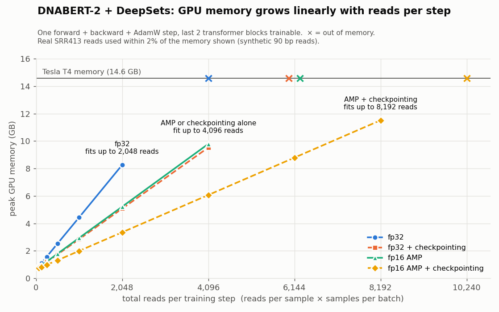

# MetagenBERT memory profile (DNABERT-2 + DeepSets, T2D)

**TL;DR.** On a single Tesla T4 (14.6 GB), one MetagenBERT-style training step
(arXiv:2601.03295) fits up to **8,192 reads per step** with fp16 AMP + gradient
checkpointing. Without either it fits 2,048, and with only one of the two it fits
4,096. The step uses DNABERT-2, last 2 blocks trainable, and a DeepSets head over
read embeddings. Peak memory is linear in total reads per step (≈ 650 MB +
1.36 MB/read with AMP + checkpointing). Real SRR413 reads match synthetic 90 bp reads
within ~2%. One epoch over all 345 samples at 4,096 reads/sample takes about
14 min of T4 GPU time. **This is a feasibility/memory profile, not an accuracy
study**: there is no training loop, no evaluation and no train/test split.



```
run_to_sample.json, sample_to_label.json   # SRA run -> sample -> label (Y = T2D, N = control)
common.py              seeding + mapping helpers
data/download.py       first K spots (read 1) for N label-balanced runs -> data/raw/
data/sample_reads.py   R seeded random reads per sample                -> data/reads/
model.py               DNABERT-2 encoder (frozen except last 2 blocks) + DeepSets head
profile_step.py        grid of single training steps                    -> results_*.csv
report.py              markdown table + memory-vs-reads chart          -> report/
plot_summary.py        summary chart across grid + ceiling runs        -> memory_summary.png
kaggle_run.sh          the full Kaggle run, in order
results/               outputs of the Kaggle T4 run (Oct 2026)
```

## Results (Kaggle Tesla T4)

All numbers are from `results/`: the 60-config synthetic grid, a synthetic ceiling
run (batch 1, 4,096–12,288 reads), and a real-data run on SRR413. Memory depends
only on **total reads per step** (reads per sample × samples per batch). For
example, 256 × 4 and 1,024 × 1 give the same peak.

**Ceiling: max reads per step before OOM**

| Variant | Max reads per step | First OOM at | Linear fit: peak ≈ 650 MB + … per read |
|---|---:|---:|---:|
| fp32 | 2,048 | 4,096 | 3.82 MB |
| fp32 + checkpointing | 4,096 | 6,144 | 2.22 MB |
| fp16 AMP | 4,096 | 6,144 | 2.29 MB |
| fp16 AMP + checkpointing | 8,192 | 10,240 | 1.36 MB |

Peak is `torch.cuda.max_memory_allocated`. The fit intercepts are 637–665 MB: roughly
the 446 MB of weights plus gradients and AdamW state for the 19.2M trainable
parameters. The linear fit is within 3% of
every measurement (largest gap ~20 MB, at 64 reads).

**Recommendation:** use fp16 AMP + checkpointing at **6k–8k reads per step** on a
16 GB card. 8,192 reads reserved 13.9 of 14.6 GB, so it fits but with little headroom;
6,144 reserved 12.5 GB. The limit is memory, not speed: 4,096 reads/step had the best
throughput (≈ 1,680 reads/s vs ≈ 1,360 reads/s at 8,192).

**Step time** at 4,096 reads (batch 1): **2.4 s** with AMP + checkpointing vs
**8.6 s** with fp32 + checkpointing (2.1 s with AMP alone). Checkpointing costs about
10–15% extra time. AMP is roughly 3.5× faster.

**Real vs synthetic:** real SRR413 reads (10 runs × 5,000 spots, 512 reads/sample)
came within **−2.1% to +0.1%** of the synthetic peak memory across all 48 shared
configs. Reads padded to 24–26 tokens, vs 25–26 for synthetic 90 bp reads.

**Epoch estimate:** 345 samples × 4,096 reads at 1 sample/step with AMP +
checkpointing is 345 × 2.44 s ≈ **14 min of T4 GPU time**. This excludes data
loading, tokenization and evaluation.

**Data notes:** the mapping has two sequencing batches. `SRR341…` has 74 N / 71 Y
(IDs like `DLF001`/`NOM029`) and `SRR413…` has 100 N / 99 Y (`CON-`/`T2D-`).
`SRR1778450` (T2D-095) is an outlier and belongs to neither batch. The real-data run
used SRR413 only.

**Charts:**
- [Synthetic grid by batch size](results/report/synthetic/memory_vs_reads.png) ([table](results/report/synthetic/results.md))
- [Real SRR413 grid by batch size](results/report/real/memory_vs_reads.png) ([table](results/report/real/results.md))

Regenerate the summary chart with `python plot_summary.py results results/memory_summary.png`.

## Model

- **Encoder:** `zhihan1996/DNABERT-2-117M`, pinned to revision `7bce263b`. Each read is
  tokenized (BPE, ≤128 tokens), encoded, then **mean-pooled over non-pad tokens**
  into a 768-d read embedding.
- **Freezing:** embeddings and blocks 0–9 are frozen; blocks 10–11 train. That is
  19.2M of 116.8M parameters. The unused pooler is dropped. Frozen blocks build no
  autograd graph, so their activations are freed right away.
- **DeepSets head:** φ is an MLP (768→256→256) applied to each read. The outputs
  are mean-pooled across reads, then ρ (256→256→1) produces one logit per sample.
  The loss is BCE-with-logits.
- **Triton / flash-attention fix:** the remote code imports a Triton flash-attention
  kernel. Current Triton versions fail to compile it, and it doesn't support the
  T4's sm_75 anyway. `load_dnabert2()` blocks `import triton` during loading and also sets
  the module's `flash_attn_qkvpacked_func = None`. Together these force the plain PyTorch
  attention path. When the fix is active, the remote code logs *"Unable to import
  Triton; defaulting … to pytorch"*. Passing transformers' `BertConfig` explicitly
  avoids the known `config_class` mismatch error.
- **Gradient checkpointing:** wraps only the 2 trainable blocks with
  `torch.utils.checkpoint` (non-reentrant). There is nothing to recompute in frozen
  blocks. This was checked on CPU: gradients are identical with and without it.

## Running on Kaggle (T4)

Settings: Accelerator **GPU T4** (one is enough), **Internet on**.

```bash
!git clone https://github.com/sabasiddique1/metagenbert-memprofile.git
!cd metagenbert-memprofile && bash kaggle_run.sh
```

`kaggle_run.sh` runs these steps in this order. Synthetic runs come first, so an SRA
download failure can't block the main results:

```bash
# 1. Only the missing packages; keep Kaggle's torch/numpy/pandas (Python 3.13)
pip install -q transformers==4.45.2 einops==0.8.0 tabulate==0.9.0
```

```bash
# 2. Synthetic grid (60 configs) and its report
python profile_step.py --synthetic --read_len 90 --out results_synthetic.csv
python report.py --results results_synthetic.csv --out_dir report/synthetic
```

```bash
# 3. Ceiling run (batch 1)
python profile_step.py --synthetic --read_len 90 --reads 4096 6144 8192 10240 12288 --batch 1 --out results_ceiling.csv
```

```bash
# 4. Real data last: sra-tools, then SRR413 only, 10 runs x 5000 spots, 512 reads/sample
wget -q https://ftp-trace.ncbi.nlm.nih.gov/sra/sdk/3.1.1/sratoolkit.3.1.1-ubuntu64.tar.gz
tar xzf sratoolkit.3.1.1-ubuntu64.tar.gz && export PATH=$PWD/sratoolkit.3.1.1-ubuntu64/bin:$PATH
mkdir -p ~/.ncbi && printf '/LIBS/GUID = "%s"\n' "$(cat /proc/sys/kernel/random/uuid)" > ~/.ncbi/user-settings.mkfg
python -m data.download --run_prefix SRR413 --n_runs 10 --spots 5000 --out data/raw
python -m data.sample_reads --manifest data/raw/manifest.csv --reads 512 --out data/reads
python profile_step.py --reads_dir data/reads --reads 64 128 256 512 --out results_real.csv
python report.py --results results_real.csv --out_dir report/real
```

Outputs land in the repo root (`results_*.csv`, `report/`) and are git-ignored there.
The curated copies from the Oct 2026 run are in `results/`. If you run the steps as
separate notebook cells, prefix each line with `!` and set `PATH` with
`os.environ["PATH"]`, since `export` doesn't persist between `!` lines. Model weights
(~470 MB) download from HF the first time they're used.

`requirements.txt` pins the full set (Python 3.13 wheels) for running outside Kaggle.

**Grid:** reads_per_sample ∈ {64,128,256,512,1024} × batch_size (samples) ∈ {1,2,4} × AMP
fp16 {off,on} × grad-ckpt {off,on}. A step encodes `batch_size × reads_per_sample`
reads at once, i.e. up to 4096 sequences.

**Each config** runs in a fresh process, which isolates OOM and fragmentation. It
does a warm-up step, which creates the AdamW state, then `reset_peak_memory_stats()`,
then one timed forward+backward+optimizer step. Each results CSV records:
- `peak_alloc_mb` (`torch.cuda.max_memory_allocated`) and `peak_reserved_mb`
- `model_mb`, the weights alone
- `step_time_s`
- `oom`
- `max_tokens`, the padded token length in the batch

## Assumptions

- **Single-end, read 1 only.** `fastq-dump --split-files` and keep `_1` (or the
  only file). Mates are ignored.
- **First K spots, not random.** `fastq-dump -X K` takes the head of each run. The
  head of a run can be biased (flowcell tile/position effects). The R reads per
  sample are random *within* those K spots. Use a larger K, or a full download, for
  anything beyond memory profiling.
- **One run per sample.** This holds for the provided mapping (345 runs ↔ 345
  samples, 174 N / 171 Y).
- **Subject-level split later.** Profiling needs no split. Any real training must
  split by sample/subject so reads from one person never appear in both train and
  test.
- Reads shorter than 50 bp are dropped. If a sample has fewer than R reads, sampling
  falls back to drawing with replacement (a warning is printed).
- Padding is to the longest read in the batch, not to a fixed 128 tokens. Memory
  therefore depends on read length. `max_tokens` is recorded per config.

## Limitations

- **Two sequencing batches in the mapping** (see Data notes above). Download
  selection is label-balanced but mixes batches unless `--run_prefix` is set. For
  training, stay within one batch or stratify by batch to avoid confounding.
- **Single-step timing.** One measured step per config is noisy and includes no
  data loading. Treat times as relative, not as throughput.
- **Peak allocated ≠ what fits.** The CUDA context (~300–500 MB) and allocator
  fragmentation sit on top. Compare `peak_reserved_mb` against the T4's 14.6 GB.
- **Plain PyTorch attention** is slower and uses more memory than flash attention.
  These numbers are an upper bound relative to an Ampere+ GPU running the Triton
  kernel. Reads are short (~25 tokens), so attention is a small share of memory
  anyway.
- No DataLoader, gradient accumulation, scheduler or evaluation. All were left out on
  purpose for this profile.
- GPU results from a Kaggle T4, Oct 2026.
